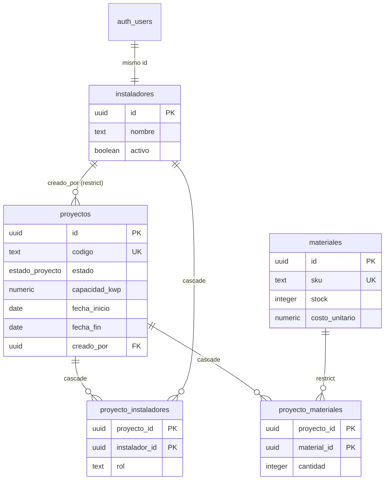

# EcoFlow — Gestión de instalaciones solares

Aplicación interna para gestionar proyectos de instalación de paneles solares.
React 18 + Vite + TypeScript en modo `strict` + Tailwind v4 + Supabase.

Este README es el **Documento de Arquitectura** del proyecto.

---

## Puesta en marcha

```bash
npm install
cp .env.example .env.local        # añade tu URL y tu anon key
npm run dev
```

Base de datos (requiere la CLI de Supabase):

```bash
supabase start
supabase db reset                                   # aplica las migraciones
psql "$DATABASE_URL" -f supabase/tests/invariantes.sql   # prueba los invariantes
npm run types:db                                    # regenera src/types/db.ts
```

| Comando | Qué hace |
|---|---|
| `npm run dev` | Servidor de desarrollo |
| `npm run typecheck` | `tsc --noEmit` sobre la app y sobre los configs |
| `npm test` | Pruebas de los esquemas de validación y utilidades |
| `npm run build` | Typecheck y bundle de producción |
| `npm run types:db` | Regenera los tipos desde el esquema real |

---

## 1. Especificación: los invariantes van antes del código

Antes de escribir una línea definí las reglas de negocio como aserciones
verificables. Son el contrato que la IA debe satisfacer y contra el que se
revisa cada respuesta suya.

| | Invariante | Dónde se garantiza |
|---|---|---|
| **I1** | Un instalador solo lee los proyectos en los que está asignado | `0002_rls.sql`, política *leo mis proyectos* |
| **I2** | Solo el coordinador asigna instaladores a un proyecto | `0002_rls.sql`, política *solo el coordinador asigna* |
| **I3** | El stock de materiales no lo escribe ningún cliente | `0002_rls.sql`, `revoke update (stock)` |
| **I4** | Un proyecto completado tiene `fecha_fin`; el cierre nunca precede al inicio | `0001_schema.sql`, constraints `completado_tiene_cierre` y `fechas_coherentes` |
| **I5** | Un material usado por un proyecto no se borra del catálogo | `0001_schema.sql`, `on delete restrict` |

Cada invariante acaba en una restricción de Postgres o en una política RLS,
nunca solo en el frontend: **el cliente valida para la UX, el servidor
garantiza**. Los cinco tienen su prueba en `supabase/tests/invariantes.sql`.

---

## 2. Esquema



### Por qué así

- **`instaladores.id` ES `auth.users.id`.** El perfil extiende al usuario en
  lugar de competir con él: la identidad tiene una sola fuente y no hay dos
  tablas que sincronizar. Un trigger crea el perfil al registrarse.
- **Clave primaria compuesta en las tablas puente.** Impide asignar dos veces
  al mismo instalador sin un índice único extra, y da gratis el índice del
  primer componente.
- **`ON DELETE` distinto según el significado.** `cascade` en las puentes,
  porque la relación no existe sin sus extremos. `restrict` en `creado_por` y
  en `material_id`, porque borrar un instalador o un material no debe borrar
  historia (I5).
- **`enum` en vez de `text` + `check`.** Valida, ocupa menos y se
  autodocumenta. El coste es que añadir un estado exige migración; se acepta
  porque son cuatro y son estables.
- **Índices sobre `instalador_id` y `estado`.** Los predicados de RLS se
  evalúan fila a fila: sin ellos, cada consulta del tablero degenera en un
  *seq scan*.
- **El importe no se almacena.** Un total copiado se desincroniza, así que se
  deriva de `proyecto_materiales` en la vista `disponibilidad`.

---

## 3. RLS

La regla que ordena todo el archivo: **RLS activada sin políticas bloquea la
tabla por completo**. Cada tabla tiene al menos una política de lectura a
propósito, no por descuido.

### La recursión infinita, y cómo se rompe

La política de `proyectos` necesita consultar `proyecto_instaladores` para
saber si estoy asignado. Y la política de `proyecto_instaladores` querría
consultar `proyectos`. Eso es **recursión infinita: error 42P17**, y es el
muro contra el que choca cualquier implementación de "solo veo mis proyectos"
sobre una relación N:M.

Se rompe con una función `SECURITY DEFINER`, que se ejecuta con los privilegios
de su dueño y por tanto no vuelve a evaluar RLS:

```sql
create or replace function public.esta_asignado(p_proyecto uuid)
returns boolean
language sql security definer set search_path = public stable
as $$
  select exists (
    select 1 from public.proyecto_instaladores
    where proyecto_id = p_proyecto and instalador_id = auth.uid()
  );
$$;
```

`set search_path = public` evita el secuestro de nombres de objeto, y `stable`
permite al planificador reutilizar el resultado dentro de la consulta.

### Tres decisiones más

- **`USING` y `WITH CHECK` en toda política de `UPDATE`.** `USING` decide qué
  filas puedes tocar; `WITH CHECK` valida la fila **resultante**. Sin lo
  segundo, un instalador se reasigna un proyecto o cambia quién lo creó.
- **El rol vive en `app_metadata`, no en `user_metadata`.** Lo segundo lo
  escribe el propio usuario con `supabase.auth.updateUser()`, lo que dejaría
  I2 en papel mojado. `app_metadata` solo se escribe desde el servidor.
- **`REVOKE` a nivel de columna.** RLS filtra **filas, no columnas**: no puede
  expresar "esta columna es de solo lectura". Eso es lo que cumple I3, y es
  también el motivo de que `codigo` y `creado_por` no aparezcan en el tipo
  `Update` de `src/types/db.ts`.

### La vista `disponibilidad`

Va deliberadamente **sin** `security_invoker`. Con él heredaría la RLS de
`proyecto_materiales` y cada instalador vería el stock reservado solo por los
proyectos que puede leer: el *disponible* saldría inflado y el dato no serviría
para planificar. Evaluada con su dueño el número es global y correcto, y el
riesgo queda acotado porque la vista solo proyecta agregados por material: no
revela ningún proyecto, cliente ni asignación.

---

## 4. Frontend

```
src/
├── types/db.ts          generado por `npm run types:db` — NO se edita a mano
├── lib/
│   ├── supabase.ts      cliente único a nivel de módulo
│   ├── schemas.ts       validación zod, espejo de los CHECK del esquema
│   └── utils.ts         cn() y formateadores
├── hooks/
│   ├── useAuth.ts       sesión y rol
│   ├── useProyectos.ts  lectura, mutaciones optimistas, loading/error
│   └── useDisponibilidad.ts
├── components/
│   ├── Dashboard.tsx    presentación pura
│   ├── ProyectoForm.tsx formulario validado
│   └── ui/              componentes base estilo shadcn
└── pages/               composición
```

La frontera es estricta: **ningún componente importa `supabase`**. Los
componentes reciben datos y callbacks, así que la capa de datos se prueba sin
montar la interfaz y la interfaz se prueba con un doble del hook.

Lo que el hook `useProyectos` **no** tiene es igual de importante: no hay ni un
`.eq('instalador_id', ...)`. El filtrado por asignación lo hace RLS en el
servidor. Si la política cambia, el hook no se toca.

Tres detalles de ciclo de vida:

- `AbortController` en cada consulta, para que una petición del filtro anterior
  no resuelva más tarde y pise el estado actual.
- `unsubscribe()` del listener de `onAuthStateChange` en el *cleanup*: sin él,
  cada montaje acumula un listener.
- Mutaciones optimistas con **rollback al estado exacto anterior**, no
  recalculando el cambio al revés. Eso cubre también el rechazo por RLS, no
  solo el error de red.

Los tipos no los escribe la IA: los genera el esquema con
`supabase gen types`. Es la pieza que mantiene una sola fuente de verdad —
si una columna cambia, la compilación rompe en lugar de fallar en producción.

---

## 5. Uso de IA

El **prompt maestro** es la especificación, no una petición: contexto, las
cinco entidades con sus invariantes I1–I5, las reglas de negocio, las
restricciones técnicas (TS `strict`, sin `any`, sin librería de estado) y los
criterios de aceptación. Cierra con dos órdenes: *"no inventes nombres de
columnas; si falta un dato, pregunta antes de generar"* y *"justifica cada
ON DELETE"*.

### El problema complejo: stock disponible

Le pedí la consulta de disponibilidad y devolvió **una sola consulta** que unía
`proyecto_materiales` y `proyecto_instaladores` desde `proyectos`, con
`SUM(cantidad)`. Compilaba y parecía correcta.

Contra un *fixture* con 2 instaladores y 3 materiales, el reservado salía al
doble. En vez de pedirle que lo arreglara le pedí que **explicara cuántas filas
devolvía el join**, y ahí salió la causa: al unir dos relaciones 1:N desde la
misma fila padre, el producto cartesiano multiplica las filas y `SUM` cuenta de
más. Cada 1:N tiene que agregarse en su propia subconsulta:

```sql
from public.materiales m
left join (
  select pm.material_id, sum(pm.cantidad) as reservado
  from public.proyecto_materiales pm
  join public.proyectos p on p.id = pm.proyecto_id
  where p.estado in ('pendiente', 'en_progreso')
  group by pm.material_id
) r on r.material_id = m.id
```

La lección quedó en el prompt maestro como restricción permanente —*"nunca
agregues sobre un join de dos relaciones 1:N; usa subconsultas separadas"*— y
el *fixture* con números conocidos es ahora test de regresión: el panel tiene
48 reservados, no 68.

Ese es el control que reclamo. La IA escribe más rápido que yo, pero el
criterio de aceptación y el caso que la desmiente los pongo yo.

---

## 6. Verificación

`npm run typecheck` limpio en `strict`, con `noUnusedLocals`,
`noUnusedParameters` y `noUncheckedIndexedAccess`. 13 pruebas de los esquemas
de validación y las utilidades. Los cinco invariantes se prueban en SQL como
coordinador y como dos instaladores distintos.

Bundle de producción medido con `npm run build`:

| Chunk | Tamaño | gzip |
|---|---|---|
| `supabase` | 225,4 kB | 59,2 kB |
| `react-vendor` | 163,2 kB | 53,3 kB |
| `index` (app) | 125,6 kB | 38,1 kB |
| `index.css` | 13,8 kB | 3,7 kB |
| `MaterialesPage` (diferido) | 1,9 kB | 0,8 kB |

`supabase-js` y `react-vendor` van en chunks propios: no reduce el peso total,
pero sobreviven en la caché del navegador al siguiente despliegue. La página de
materiales sale del chunk inicial con `React.lazy`; la de proyectos **no** se
difiere a propósito, porque es la ruta de entrada y la que marca el LCP.
